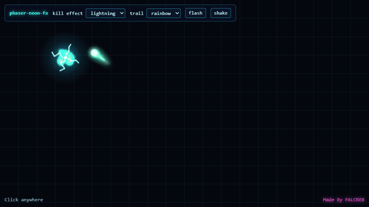

# phaser-neon-fx

Small neon visual effects library for [Phaser 4](https://phaser.io): particle bursts, expanding rings, kill effects, screen flash, shake and glowing trails. All textures are drawn in code, so there are no image files to load.

**[▶ Try the live demo](https://berkantshn.github.io/phaser-neon-fx/)** · See these effects in a real game: **[play Overload](https://overload.falcreb.com)**

[](https://berkantshn.github.io/phaser-neon-fx/)

[Türkçe](#türkçe)

## Install

The package is not on npm yet, so install it from a local copy. Phaser is a peer dependency: your project provides it.

```sh
git clone https://github.com/berkantshn/phaser-neon-fx.git phaser-neon-fx
cd my-game
pnpm add phaser file:../phaser-neon-fx
```

## Usage

```js
import Phaser from 'phaser';
import { Effects, SparkTrail } from 'phaser-neon-fx';

class MyScene extends Phaser.Scene {
  create() {
    this.fx = new Effects(this, { killKind: 'lightning', accentColor: 0xff4fd8 });
    this.trail = new SparkTrail(this, { rainbow: true });

    this.input.on('pointerdown', (p) => {
      this.fx.killBurst(p.x, p.y, 0x2ee6ff, 24);
      this.fx.ring(p.x, p.y, 90, 0x2ee6ff);
    });
  }

  update(_time, delta) {
    const pointer = this.input.activePointer;
    this.trail.update(delta / 1000, pointer.x, pointer.y);
  }
}
```

## API

### `new Effects(scene, options?)`

| Option | Default | Meaning |
| --- | --- | --- |
| `depth` | `7` | Draw order of particles, rings and shapes |
| `flashDepth` | `901` | Draw order of the screen flash |
| `killKind` | `'default'` | `default`, `shower`, `ring`, `gold`, `shock`, `glitch`, `circuit`, `electrons`, `lightning` |
| `accentColor` | `0x2ee6ff` | Accent of `shock` and the shaped kinds |
| `lowQuality` | `false` | Halves particles, skips extra rings and shapes |
| `killFxMinGap` | `0.05` | Minimum seconds between kill rings and shapes |
| `shapePoolSize` | `8` | Shaped effects that can play at once (extras are skipped) |
| `screenShake` | `true` | `false` turns `shake()` off |
| `vibration` | `true` | `false` turns `vibrate()` off |
| `flashes` | `true` | `false` turns `flash()` off |

All options except `shapePoolSize` can be changed later as properties, for example `fx.flashes = false`.

| Method | Effect |
| --- | --- |
| `burst(x, y, color, count)` | Particle explosion |
| `ring(x, y, radius, color, duration = 350)` | Expanding, fading ring (ms) |
| `killBurst(x, y, color, count)` | Burst plus the current `killKind` |
| `killShape(x, y, kind, color)` | Plays one shaped kind directly |
| `flash(color, alpha, duration)` | Full screen flash (ms) |
| `shake(durationMs, intensity)` | Camera shake |
| `vibrate(pattern)` | Device vibration, ignored where unsupported |

### `new SparkTrail(scene, options?)`

Call `trail.update(dtSeconds, x, y)` every frame and `trail.destroy()` to remove it. `trail.boost` multiplies its lifetime (default `1`).

| Option | Default | Meaning |
| --- | --- | --- |
| `textureKey` | `TEXTURE_KEYS.glow` | Texture of the points. Use `TEXTURE_KEYS.white` for pure tints |
| `tint` | `0xffffff` | Single colour |
| `tints` | `null` | Colour blocks, `[c1, c2, ...]` |
| `rainbow` | `false` | Cycling hue |
| `aurora` | `null` | Wave between two colours, `[c1, c2]` |
| `pulse` | `false` | Brightness wave |
| `sparkle` | `false` | Points twinkle white |
| `lifetime` | `0.35` | Seconds a point lives |
| `spacing` | `4` | Pixels between points |
| `maxPoints` | `80` | Pooled images |
| `radius` | `26` | Radius at the head |
| `startAlpha` | `0.6` | Alpha at the head |
| `endSize` | `0.2` | Size at the tail, relative to the head |
| `depth` | `9` | Draw order |

### Other exports

`createGlowTextures(scene)` (called for you by both classes), `TEXTURE_KEYS`, `GLOW_TEXTURE_SIZE`, `drawKillShape(g, kind, p, color, accent, s = 1)`, `SHAPED_KILL_KINDS`, `KILL_SHAPE_DURATION`, `trailPointLook(look, i, phase, time, hue = 0)`, `DEFAULT_EFFECTS_OPTIONS`, `DEFAULT_TRAIL_OPTIONS`.

## Run the demo

```sh
pnpm install
pnpm dev
```

Open the address Vite prints and click anywhere. `pnpm build` writes the demo to `dist/`.

## License

[MIT](LICENSE)

---

## Türkçe

[Phaser 4](https://phaser.io) için küçük bir neon görsel efekt kütüphanesi: parçacık patlamaları, genişleyen halkalar, öldürme efektleri, ekran flaşı, sarsıntı ve parlayan izler. Tüm dokular kodla çizilir, yüklenecek görsel dosyası yoktur.

**[▶ Canlı demoyu dene](https://berkantshn.github.io/phaser-neon-fx/)** · Efektleri gerçek bir oyunda gör: **[Overload'u oyna](https://overload.falcreb.com)**

### Kurulum

Paket henüz npm'de yok, bu yüzden yerel bir kopyadan kurulur. Phaser, peer dependency'dir (kullanan projenin kendisinin kurduğu bağımlılık).

```sh
git clone https://github.com/berkantshn/phaser-neon-fx.git phaser-neon-fx
cd oyunum
pnpm add phaser file:../phaser-neon-fx
```

### Kullanım

```js
import { Effects, SparkTrail } from 'phaser-neon-fx';

// Sahnenin create() fonksiyonunda:
const fx = new Effects(this, { killKind: 'lightning' });
const trail = new SparkTrail(this, { rainbow: true });

fx.killBurst(x, y, 0x2ee6ff, 24); // Patlama + seçili öldürme efekti
fx.ring(x, y, 90, 0x2ee6ff); // Genişleyip solan halka
fx.flash(0x2ee6ff, 0.35, 260); // Ekran flaşı
fx.shake(200, 0.01); // Kamera sarsıntısı

// Sahnenin update(time, delta) fonksiyonunda:
trail.update(delta / 1000, x, y);
```

Tüm ayarların ve fonksiyonların listesi yukarıdaki [API](#api) bölümündedir. Ayarlar düz nesne olarak verilir, verilmeyenler varsayılan değerde kalır.

### Demoyu çalıştırma

```sh
pnpm install
pnpm dev
```

Vite'ın yazdığı adresi aç ve ekranda herhangi bir yere tıkla. `pnpm build`, demoyu `dist/` klasörüne derler.

### Lisans

[MIT](LICENSE)

---

## ⭐ Support this project

If this project helped you, please give it a ⭐ and [follow me on GitHub](https://github.com/berkantshn) for more.

İşine yaradıysa projeye ⭐ verip [beni GitHub'da takip edebilirsin](https://github.com/berkantshn).

---

Made By FALCREB
